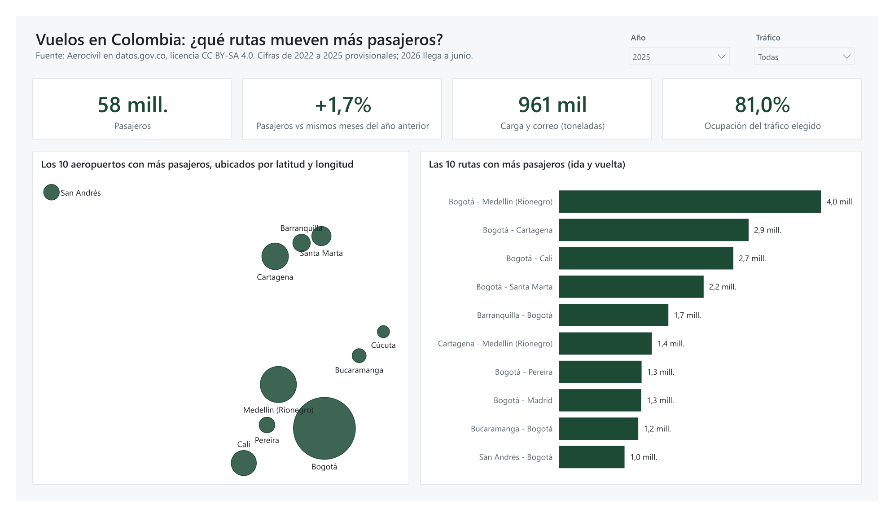
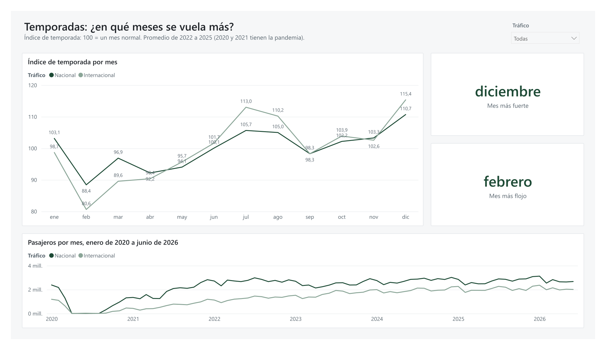
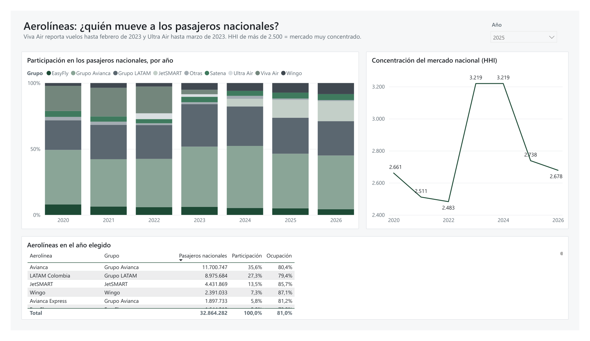
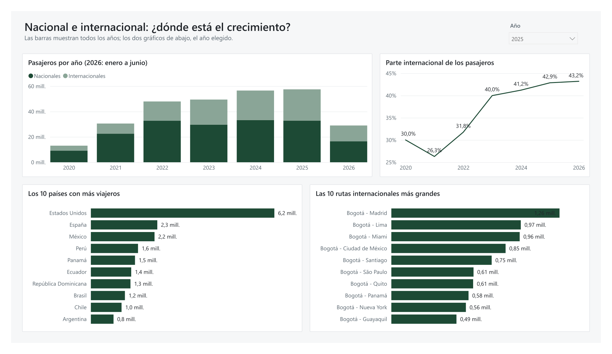
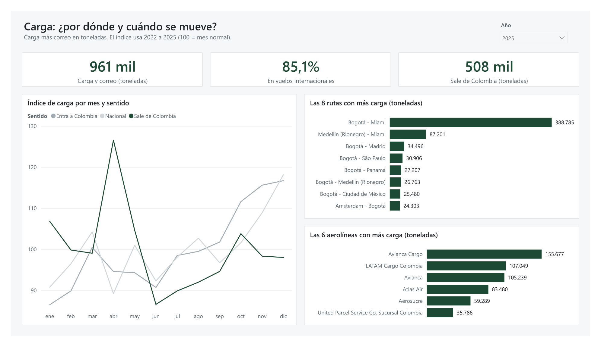

# Flights in Colombia: routes, seasons and airlines

[Versión en español](README.md)

I wanted to know which routes carry the most passengers and cargo in Colombia, which months are busiest and which airlines fly them. I took the open data from Aerocivil (Colombia's civil aviation authority), January 2020 to June 2026, cleaned it with SQL and Power Query and built a Power BI dashboard.



## What I found

**1. The domestic market didn't grow. All the growth was international.**
Between 2022 and 2025 domestic passengers went from 32.7 to 32.9 million: only 0.4% more. International passengers went from 15.2 to 24.7 million, 61.9% more. International is now 42.9% of all passengers, up from 31.8% in 2022.

**2. When Viva Air and Ultra Air stopped flying, Avianca and LATAM took the market. Then JetSMART arrived.**
In 2022 Viva and Ultra had 24.7% of domestic passengers. In the data, Viva reports until February 2023 and Ultra until March. That year Avianca and LATAM (with their subsidiaries) went from 62.3% to 77.9%, and the HHI concentration index rose from 2,483 to 3,219 (above 2,500 is considered highly concentrated). By 2025 JetSMART had 13.5%, Avianca and LATAM were down to 68.7% and the HHI was 2,738.

**3. Almost everything goes through Bogotá, but the routes that are growing don't.**
69.5% of domestic passengers in 2025 flew a route that starts or ends at El Dorado. The biggest route is Bogotá - Medellín, with 4.0 million passengers in 2025. Point-to-point routes (for example Medellín - Cartagena or Cali - Cartagena) were Viva's: they fell 20.4% between 2022 and 2024. In 2025 they grew 5.2%, while Bogotá routes fell 3.8%.

**4. December is the strongest month and February the weakest.**
With an index where 100 is a normal month, December scores 110.7 on domestic flights and February 88.4 (2022 to 2025 average). So December moves 25% more passengers than February. July and August are the second peak season. If I had to plan capacity or staff, that's where I'd look first.

**5. Air cargo is international, leaves through Bogotá to Miami and peaks in April.**
85.1% of the tonnes in 2025 flew on international flights. The Bogotá - Miami route alone carried 47.5% of that international cargo. Cargo leaving Colombia peaks in April, with an index of 126.6. The data doesn't say what is shipped, but the peak matches the flower season before Mother's Day. That's a hypothesis, not a fact from the data.

One more: on regular domestic flights planes are 81.5% full (2025), based on the seats offered that Aerocivil reports.

## The dashboard

Five pages, one per question. One accent color and the filters on top (year, domestic or international, airline).

| Page | What it answers |
|---|---|
| Overview and routes | How many passengers, how much cargo, and the main routes on the map |
| Seasons | Which months are busiest (index 100 = normal month) |
| Airlines | Who has which share of the market and how it changed since 2022 |
| Domestic and international | How each one grows and which countries people fly to |
| Cargo | Tonnes by route, by direction (outbound or inbound) and by month |






Full dashboard as PDF: [docs/tablero.pdf](docs/tablero.pdf). The DAX measures can be read without Power BI in [dax/medidas.md](dax/medidas.md) and the Power Query cleaning in [powerquery/](powerquery/). The dashboard itself is in Spanish.

## Where the data comes from

Unidad Administrativa Especial de Aeronáutica Civil (Aerocivil), published on datos.gov.co under [CC BY-SA 4.0](https://creativecommons.org/licenses/by-sa/4.0/):

- [Commercial Air Transport: Origin-Destination Traffic](https://www.datos.gov.co/d/gb6w-ynu4) (`gb6w-ynu4`): 478,010 rows. Airline, month, origin and destination airport, domestic or international, passengers and cargo plus mail in kilos.
- [Air Transport: Traffic by Aircraft Type](https://www.datos.gov.co/d/djjf-g4q4) (`djjf-g4q4`): 216,599 rows. The same by aircraft type, with flights, hours and seats offered. Load factor comes from here.

Things to keep in mind:

- **Figures for 2022 to 2025 are provisional.** Aerocivil may correct them. That's why the repo has a fixed copy, downloaded on November 4, 2026, and a test that warns if the source changed.
- **2026 only goes to June.** 2026 is not compared against full years.
- **2020 and 2021 are distorted by the pandemic** (from April to August 2020 there were almost no passenger flights). Seasons are calculated with 2022 to 2025.
- **Only traffic to, from or within Colombia.** I removed 12,240 rows of "Special" traffic: flights between two foreign countries, like Panama - Havana, run by a Colombian airline. I also removed 10 cargo rows marked as international that never touch Colombia (Montevideo - Ezeiza, for example).
- **Cargo includes mail**, because that's how Aerocivil reports it.
- I added the brand name for the big airlines (for example, AIRES is LATAM Colombia and FAST COLOMBIA was Viva Air) in a short list inside [sql/02_limpiar.sql](sql/02_limpiar.sql). The rest use the name they report.

Derived data in this repo (the copy in `datos/fuente/` and the CSVs in `resultados/`) keeps the same CC BY-SA 4.0 license. The code is MIT.

## How I built it

1. **Data:** a script downloads both datasets from the datos.gov.co API (no key, 50,000 rows per page, with retries) and checks that every row arrived.
2. **Cleaning in SQL (DuckDB):** types, 52 rows with no passengers that I count as 0 and flag, cities written two ways ("CALI" and "SANTIAGO DE CALI"), one airline with several names, and routes without direction (Bogotá - Medellín adds both ways).
3. **Queries:** 9 analysis queries in numbered, commented `.sql` files, with CTEs and window functions (`rank`, `lag`, shares and running totals).
4. **Tests:** 38 tests that run on GitHub Actions. They check that yearly totals match the ones the API itself calculates, that cleaning doesn't lose or duplicate rows and that every number in this README comes from the data.
5. **Power BI:** Power Query reads the same copy and cleans it with the same steps. DAX measures and the five pages go on top.

I defined the plan and the questions. The code was written by Claude (AI) and I checked every number against the source.

```
sql/          numbered queries (01 load, 02 clean, 10 to 18 analysis)
scripts/      descargar_datos.py (download) and correr_sql.py (run queries)
tests/        pytest tests
datos/fuente/ fixed copy of the Aerocivil data in Parquet (6 MB) and its official totals
resultados/   what each query returns, as CSV
powerbi/      the dashboard (.pbix)
powerquery/   the Power Query cleaning, as text
dax/          the DAX measures, as text
capturas/     dashboard screenshots
docs/         the dashboard as PDF
```

## How to run it

You need Python 3.12.

```bash
git clone https://github.com/Dsergio909/vuelos-colombia.git
cd vuelos-colombia
python -m venv .venv
.venv/Scripts/activate        # on Linux or Mac: source .venv/bin/activate
pip install -r requirements.txt
python -m pytest              # tests
python scripts/correr_sql.py  # recalculates resultados/
```

To download the latest Aerocivil data: `python scripts/descargar_datos.py` (about 2 minutes). To compare the copy against the live API: `python -m pytest -m en_linea`.

To open the dashboard: Power BI Desktop (free). In Power Query, set the `CarpetaDatos` parameter to the `datos/fuente` folder of your copy of the repo and click **Refresh**.

## What's missing

- The data has no fares, delays or cancellations. You can't tell if a route is profitable or how punctual an airline is.
- It doesn't say what kind of cargo is shipped either. The link between the April peak and flowers is a hypothesis.
- Routes are between airports. A passenger flying Cali to Madrid through Bogotá may show up as two legs.
- A monthly passenger forecast for 2026 is still to be tried.

## How to explain it in 2 minutes

"I took the open data from Aerocivil: almost 700,000 rows of flights from 2020 to June 2026. The question was which routes, which months and which airlines move the country's people and cargo.

First I cleaned it with SQL, in DuckDB. There were cities written two ways, rows with no passengers and airlines with several names. I left automated tests that compare my totals with the source, so I know I didn't lose or invent anything.

Three things stood out. One, since 2022 the domestic market is flat and all the growth is international. Two, when Viva Air and Ultra Air left in 2023, Avianca and LATAM went from 62% to 78% of domestic passengers, and the routes that don't go through Bogotá dropped. JetSMART is winning part of that back. Three, cargo is almost all international, half of it flies Bogotá - Miami and it peaks in April.

All of that is in a five-page Power BI dashboard, one page per question. If this were an airline or an airport, I'd use it to plan capacity and staff by season."

## License

Code: MIT. Data: Aerocivil, CC BY-SA 4.0 (see above).
