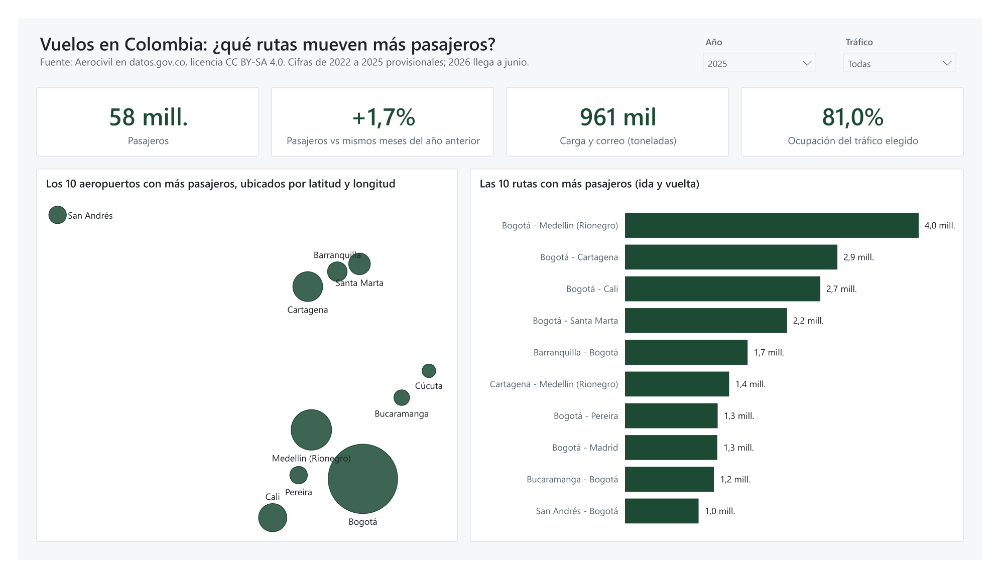
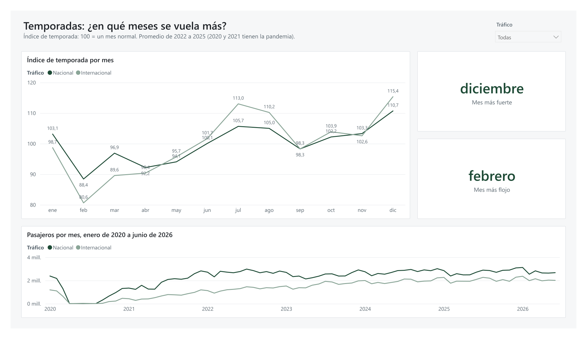
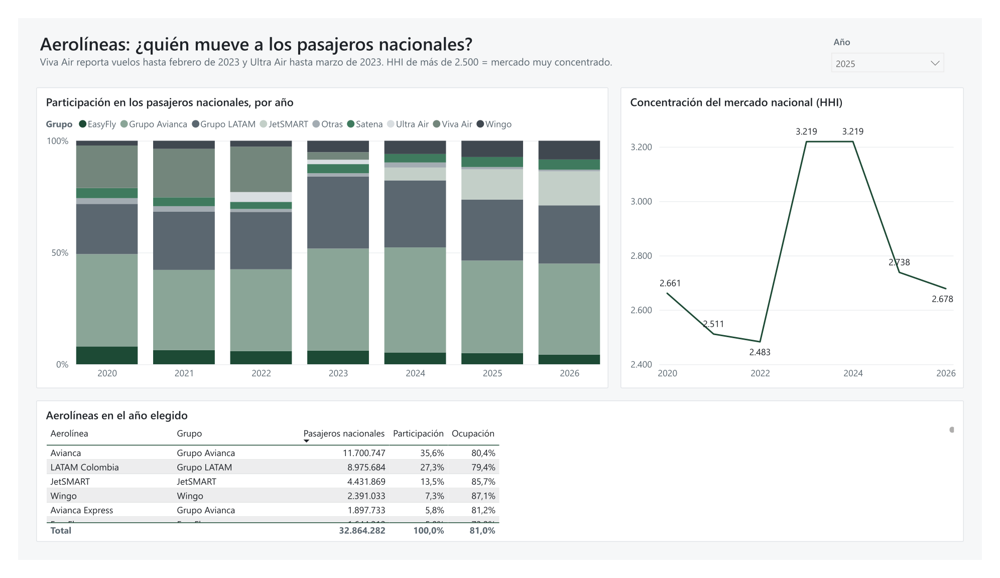
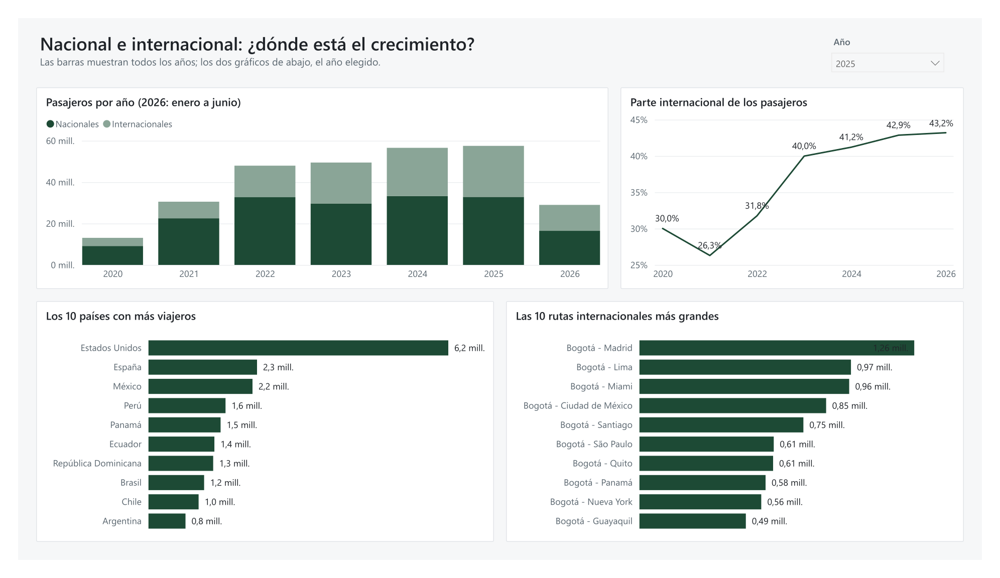
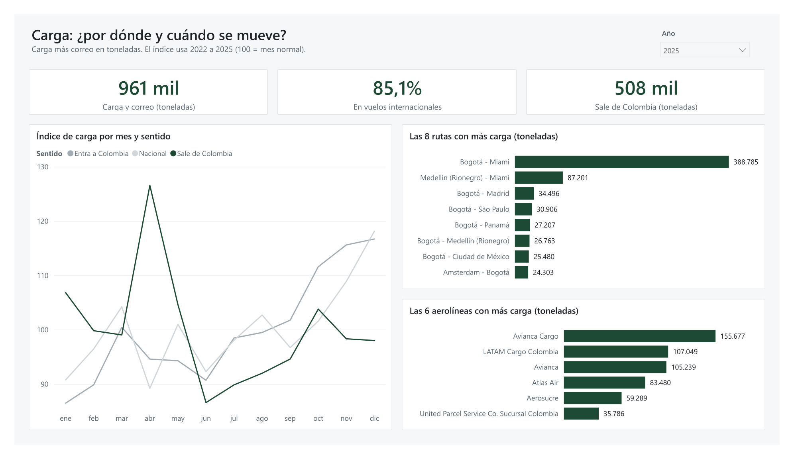

# Vuelos en Colombia: rutas, temporadas y aerolíneas

[English version](README.en.md)

Quería saber qué rutas mueven más pasajeros y carga en Colombia, en qué meses se vuela más y con qué aerolíneas. Tomé los datos abiertos de la Aerocivil, de enero de 2020 a junio de 2026, los limpié con SQL y Power Query y armé un tablero en Power BI.



## Lo que encontré

**1. Lo nacional no creció. Todo el crecimiento fue internacional.**
Entre 2022 y 2025 los pasajeros nacionales pasaron de 32,7 a 32,9 millones: apenas 0,4 % más. Los internacionales pasaron de 15,2 a 24,7 millones, un 61,9 % más. Por eso lo internacional ya es el 42,9 % de los pasajeros, cuando en 2022 era el 31,8 %. Ojo: en el primer semestre de 2026 lo nacional sí creció, 6,1 % contra el mismo semestre de 2025. Habrá que ver si se sostiene.

**2. Cuando Viva Air y Ultra Air dejaron de volar, Avianca y LATAM se quedaron con el mercado. Después llegó JetSMART.**
En 2022 Viva y Ultra tenían el 24,7 % de los pasajeros nacionales. En los datos, Viva reporta hasta febrero de 2023 y Ultra hasta marzo. Ese año Avianca y LATAM (con sus filiales) pasaron del 62,3 % al 77,9 %, y el índice de concentración HHI subió de 2.483 a 3.219 (por encima de 2.500 se considera muy concentrado). En 2025 JetSMART ya tenía el 13,5 %, Avianca y LATAM bajaron a 68,7 % y el HHI quedó en 2.738.

**3. Casi todo pasa por Bogotá, pero las rutas que crecen no pasan por allá.**
El 69,5 % de los pasajeros nacionales de 2025 volaron en una ruta que empieza o termina en El Dorado. Ojo: Aerocivil cuenta pasajeros por tramo de vuelo, así que quien va de Cali a Cartagena con escala en Bogotá cuenta en los dos tramos. La ruta más grande es Bogotá - Medellín, con 4,0 millones de pasajeros en 2025. En las rutas punto a punto (por ejemplo Medellín - Cartagena o Cali - Cartagena), Viva era la aerolínea más grande: en 2022 llevaba el 31,7 % de sus pasajeros, casi un tercio. Esas rutas cayeron 20,4 % entre 2022 y 2024. En 2025 crecieron 5,2 %, mientras las rutas de Bogotá cayeron 3,8 %.

**4. Diciembre es el mes más fuerte y febrero el más flojo.**
Con un índice donde 100 es un mes normal, en vuelos nacionales diciembre marca 110,7 y febrero 88,4 (promedio de 2022 a 2025). O sea, en diciembre se mueve un 25 % más de pasajeros que en febrero. Julio y agosto son la segunda temporada alta. Si yo tuviera que planear capacidad o personal, ahí es donde me fijaría primero.

**5. La carga aérea es internacional, sale por Bogotá hacia Miami y tiene su pico en abril.**
El 85,1 % de las toneladas de 2025 fueron de vuelos internacionales. Solo la ruta Bogotá - Miami llevó el 47,5 % de esa carga internacional. La carga que sale de Colombia tiene su pico en abril, con un índice de 126,6. Los datos no dicen qué se lleva, pero el pico coincide con la temporada de flores del Día de la Madre. Eso queda como hipótesis, no como dato.

**Un pronóstico simple para el segundo semestre de 2026.**
Con el índice de temporada de los tres años anteriores y lo real de enero a junio, armé un pronóstico de julio a diciembre. Primero lo probé con 2025, como si no supiera qué iba a pasar: en lo nacional se equivocó en 3,4 % por mes en promedio, pero en lo internacional en 12,0 %. Eso pasa porque los años de base todavía traen la recuperación de la pandemia. Así que solo me fío del nacional: para julio a diciembre de 2026 da 18,2 millones de pasajeros. El cálculo está en [sql/19_pronostico.sql](sql/19_pronostico.sql).

Un dato más: en vuelos nacionales regulares los aviones van llenos en un 81,5 % (2025), según las sillas ofrecidas que reporta Aerocivil. Si se suman los internacionales da 81,0 %, que es la cifra que muestra el tablero cuando no se filtra el tráfico.

## El tablero

Cinco páginas, una por pregunta, y una sexta de control que muestra los totales por año para compararlos con el SQL. Un solo color de acento y dos filtros arriba: año y tráfico (nacional o internacional).

| Página | Qué responde |
|---|---|
| Resumen y rutas | Cuántos pasajeros, cuánta carga, las 10 rutas principales y los 10 aeropuertos más grandes ubicados por latitud y longitud |
| Temporadas | Qué meses se vuela más (índice 100 = mes normal) |
| Aerolíneas | Quién tiene qué parte del mercado y cómo cambió desde 2022 |
| Nacional e internacional | Cómo crece cada uno y a qué países se viaja |
| Carga | Toneladas por ruta, por sentido (sale o entra) y por mes |






El tablero completo en PDF: [docs/tablero.pdf](docs/tablero.pdf). Las medidas DAX se pueden leer sin Power BI en [dax/medidas.md](dax/medidas.md) y la limpieza de Power Query en [powerquery/](powerquery/).

## De dónde salen los datos

Unidad Administrativa Especial de Aeronáutica Civil (Aerocivil), publicados en datos.gov.co con licencia [CC BY-SA 4.0](https://creativecommons.org/licenses/by-sa/4.0/deed.es):

- [Transporte Aéreo Comercial: Tráfico Origen-Destino](https://www.datos.gov.co/d/gb6w-ynu4) (`gb6w-ynu4`): 478.010 filas. Aerolínea, mes, aeropuerto de origen y de destino, nacional o internacional, pasajeros y carga más correo en kilos.
- [Transporte Aéreo: Tráfico por Equipo](https://www.datos.gov.co/d/djjf-g4q4) (`djjf-g4q4`): 216.599 filas. Lo mismo por tipo de avión, con vuelos, horas y sillas ofrecidas. De aquí sale la ocupación.

Lo que hay que tener en cuenta:

- **Las cifras de 2022 a 2025 son provisionales.** Aerocivil las puede corregir. Por eso el repo trae una copia fija, bajada el 4 de noviembre de 2026, y una prueba que avisa si la fuente cambió.
- **2026 llega hasta junio.** No se compara 2026 contra años completos.
- **2020 y 2021 están deformados por la pandemia** (de abril a agosto de 2020 casi no hubo vuelos de pasajeros). Las temporadas se calculan con 2022 a 2025.
- **Solo tráfico de Colombia.** Quité 12.240 filas de tráfico "Especial": vuelos entre dos países extranjeros, como Panamá - La Habana, que hace una aerolínea colombiana. También quité 29 filas cuyo tráfico no cuadra con los países: 10 de carga marcadas como internacionales que no tocan Colombia (Montevideo - Ezeiza, por ejemplo) y 19 marcadas como nacionales que salen de México (138 pasajeros en 2022). Y como un mismo código puede ser un aeropuerto de Colombia y otro del exterior (IDA es Puerto Inírida y también Idaho), cada ruta se identifica por sus dos códigos y por si es nacional o internacional.
- **Carga incluye correo**, porque así la reporta Aerocivil.
- La marca comercial de cada aerolínea (por ejemplo, AIRES es LATAM Colombia y FAST COLOMBIA era Viva Air) la puse yo, en una lista corta dentro de [sql/02_limpiar.sql](sql/02_limpiar.sql). Las demás aerolíneas usan el nombre que reportan.

Las coordenadas de los aeropuertos para el mapa vienen de [OurAirports](https://ourairports.com/data/) (dominio público), unidas por código IATA en [scripts/coordenadas_aeropuertos.py](scripts/coordenadas_aeropuertos.py).

Los datos derivados de este repo (la copia en `datos/fuente/`, los CSV de `resultados/`, el PDF y las capturas) quedan con la misma licencia CC BY-SA 4.0: ver [datos/LICENSE.md](datos/LICENSE.md) y [resultados/LICENSE.md](resultados/LICENSE.md). El código tiene licencia MIT. La licencia no la escribí a mano: `scripts/descargar_datos.py` la lee de los metadatos de cada conjunto y una prueba revisa que siga siendo la misma.

## Cómo lo hice

1. **Datos:** un script baja los dos conjuntos por la API de datos.gov.co (sin clave, en páginas de 50.000 filas, con reintentos) y comprueba que llegaron todas las filas.
2. **Limpieza en SQL (DuckDB):** tipos, 52 filas sin pasajeros que cuento como 0 y dejo marcadas, ciudades escritas de dos formas ("CALI" y "SANTIAGO DE CALI"), una misma aerolínea con varios nombres y rutas sin dirección (Bogotá - Medellín suma los dos sentidos).
3. **Consultas:** 10 consultas de análisis en archivos `.sql` numerados y comentados (incluye un informe de calidad de datos y el pronóstico), con CTE y funciones de ventana (`rank`, `lag`, participaciones y acumulados).
4. **Pruebas:** 41 pruebas que corren en GitHub Actions con cada cambio, y 4 más que se corren a mano y comparan contra la API en vivo (totales y licencia). Revisan que los totales por año cuadren con los que calcula la propia API, que la limpieza no pierda ni duplique filas y que cada cifra de este README salga de los datos.
5. **Power BI:** Power Query lee la misma copia y la limpia con los mismos pasos. Encima van las medidas DAX y las seis páginas.

El plan y las preguntas los definí yo. El código lo escribió Claude (IA) y yo revisé cada cifra contra la fuente.

```
sql/          consultas numeradas (01 cargar, 02 limpiar, 10 a 20 análisis y calidad, 99 cifras del README)
scripts/      descargar_datos.py, correr_sql.py y coordenadas_aeropuertos.py
tests/        pruebas con pytest
datos/fuente/ copia fija de Aerocivil en Parquet (6 MB) y sus totales oficiales
datos/referencia/ coordenadas de los aeropuertos (OurAirports)
resultados/   lo que devuelve cada consulta, en CSV
powerbi/      el tablero como proyecto de Power BI en texto (.pbip)
powerquery/   la limpieza de Power Query, en texto
dax/          las medidas DAX, en texto
capturas/     imágenes del tablero
docs/         el tablero en PDF
```

## Cómo correrlo

Necesitas Python 3.12.

```bash
git clone https://github.com/Dsergio909/vuelos-colombia.git
cd vuelos-colombia
python -m venv .venv
.venv\Scripts\activate       # Windows; en Linux o Mac: source .venv/bin/activate
pip install -r requirements.txt
python -m pytest              # pruebas
python scripts/correr_sql.py  # vuelve a calcular resultados/
```

Para bajar los datos más recientes de Aerocivil: `python scripts/descargar_datos.py` (unos 2 minutos). Para comparar la copia contra la API en vivo: `python -m pytest -m en_linea`.

Para abrir el tablero: Power BI Desktop (gratis). Abre `powerbi/vuelos-colombia.pbip`, cambia en Power Query el parámetro `CarpetaDatos` a la carpeta `datos` de tu copia del repo y pulsa **Actualizar**.

## Qué le falta

- Los datos no traen tarifas, retrasos ni cancelaciones. No se puede saber si una ruta es rentable ni qué tan puntual es una aerolínea.
- Tampoco dicen qué tipo de carga se mueve. La relación entre el pico de abril y las flores es una hipótesis.
- Las rutas son entre aeropuertos. Un pasajero que va de Cali a Madrid por Bogotá puede quedar como dos trayectos.
- El pronóstico es simple a propósito. Un modelo con tendencia o con más años serviría mejor para lo internacional.
- El mapa no tiene fondo con el contorno del país. El mapa de Power BI (Azure Maps) pide iniciar sesión con una cuenta, así que usé un gráfico de dispersión con la latitud y la longitud de cada aeropuerto. Se lee igual y lo puede abrir cualquiera.

## Cómo explicarlo en 2 minutos

"Tomé los datos abiertos de la Aerocivil: casi 700.000 filas de vuelos de 2020 a junio de 2026. La pregunta era qué rutas, qué meses y qué aerolíneas mueven a la gente y a la carga del país.

Primero los limpié con SQL, en DuckDB. Había ciudades escritas de dos formas, filas sin pasajeros y aerolíneas con varios nombres. Dejé pruebas automáticas que comparan mis totales con los de la fuente, así sé que no perdí ni inventé nada.

Lo que más me llamó la atención fueron tres cosas. Uno, desde 2022 el mercado nacional está quieto y todo el crecimiento es internacional. Dos, cuando Viva Air y Ultra Air salieron en 2023, Avianca y LATAM pasaron de 62 % a 78 % de los pasajeros nacionales, y las rutas que no pasan por Bogotá se cayeron. JetSMART está recuperando parte de eso. Tres, la carga es casi toda internacional, casi la mitad va en la ruta Bogotá - Miami y tiene su pico en abril.

Todo eso está en un tablero de Power BI de cinco páginas, una por pregunta. Si esto fuera una aerolínea o un aeropuerto, lo usaría para planear capacidad y personal por temporada."

## Licencia

Código: MIT. Datos: Aerocivil, CC BY-SA 4.0 ([datos/LICENSE.md](datos/LICENSE.md) y [resultados/LICENSE.md](resultados/LICENSE.md)). La licencia MIT no cubre los datos.
